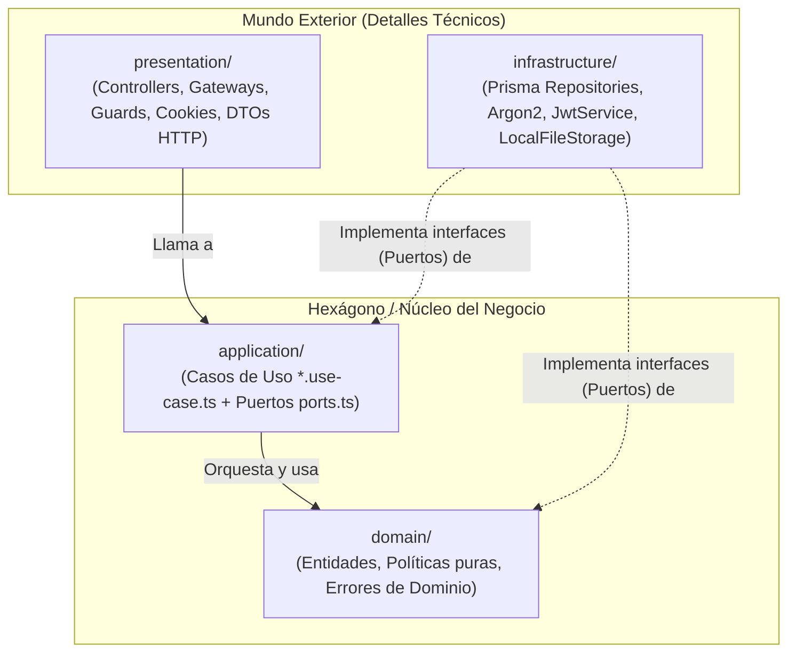
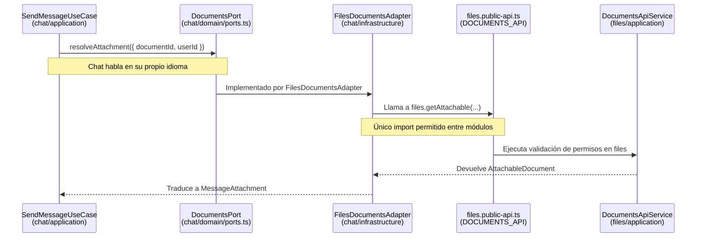

# 🏛️ 01 - Arquitectura Limpia, Hexagonal y Monolito Modular en SisDoc

Este documento explica **qué arquitectura utiliza el `@backend` de SisDoc**, **por qué está diseñada así** y **para qué sirve cada concepto** en el mundo real, usando ejemplos directos de tu propio código.

---

## 1. ¿Qué arquitectura tiene este Backend?

El backend de SisDoc combina **tres patrones complementarios** de la ingeniería de software moderna:

1. **Monolito Modular (Modular Monolith):**
   - **¿Qué es?** Es una sola aplicación desplegable (un solo servidor Node/NestJS y una sola base de datos PostgreSQL), pero internamente está dividida en **módulos de negocio independientes y estrictamente aislados** (`auth`, `files`, `chat`).
   - **¿Para qué sirve?** Te da la simplicidad operativa de un monolito (sin la complejidad de red de 10 microservicios), pero evita el temido *"espagueti"* donde todos los archivos importan todo de todos lados. Si el día de mañana `chat` crece tanto que necesita ser un microservicio independiente, puedes extraer la carpeta `src/modules/chat` casi sin tocar `auth` ni `files`.

2. **Arquitectura Limpia (Clean Architecture - Robert C. Martin):**
   - **¿Qué es?** Organiza el código en **capas concéntricas** donde la lógica de negocio vive en el centro (`domain` y `application`) y los detalles técnicos (base de datos, HTTP, WebSockets, disco duro, librerías como Argon2 o Prisma) viven en la periferia (`infrastructure` y `presentation`).
   - **La Regla de Oro (Regla de Dependencia):** Las dependencias del código fuente (`import ... from ...`) **solo pueden apuntar hacia adentro** (hacia el negocio), jamás hacia afuera (hacia los detalles técnicos).

3. **Arquitectura Hexagonal / Puertos y Adaptadores (Alistair Cockburn):**
   - **¿Qué es?** Es el mecanismo práctico para lograr la Arquitectura Limpia. El núcleo de negocio define **Puertos** (interfaces TypeScript + `Symbol`) que dicen *"qué necesito del mundo exterior"*, y la capa de infraestructura provee **Adaptadores** (clases con `@Injectable()`) que dicen *"cómo se hace eso con Prisma, Argon2, JWT o el disco local"*.

---

## 2. ¿Por qué y para qué sirve esta arquitectura? (El problema que resuelve)

En un proyecto tradicional en NestJS (sin arquitectura hexagonal), un servicio típico se ve así:

```typescript
// ❌ ESTILO ACOPLADO TRADICIONAL (Lo que SisDoc EVITA)
@Injectable()
export class AuthService {
  constructor(private prisma: PrismaService, private jwt: JwtService) {}

  async login(dto: LoginDto, res: Response) {
    const user = await this.prisma.user.findUnique({ where: { email: dto.email } });
    if (!user || !(await argon2.verify(user.passwordHash, dto.password))) {
      throw new UnauthorizedException('Credenciales inválidas');
    }
    res.cookie('token', this.jwt.sign({ sub: user.id }));
    return user;
  }
}
```

### ¿Qué tiene de malo ese código acoplado?
1. **Mezcla 4 responsabilidades:** Sabe de HTTP (`res.cookie`, `UnauthorizedException`), sabe de SQL/ORM (`this.prisma.user`), sabe de criptografía (`argon2`, `this.jwt`) y tiene reglas de negocio en medio.
2. **Es lentísimo y difícil de probar:** Para probar qué pasa al 5.º intento fallido o qué pasa cuando pasan 30 minutos de inactividad, estás obligado a levantar PostgreSQL o a escribir 50 líneas de `jest.fn().mockResolvedValue(...)` que se rompen cada vez que cambias una consulta de Prisma.
3. **Te ata a la tecnología:** Si mañana cambias el almacenamiento de archivos de disco local a AWS S3, o si quieres usar el mismo caso de uso desde HTTP REST y desde WebSockets (`ChatGateway`), tienes que reescribir la lógica de negocio.

### ✅ ¿Qué ganas con la Arquitectura Hexagonal de SisDoc?
1. **Pruebas instantáneas y deterministas:** En `login.use-case.spec.ts` se prueban 25 escenarios complejos de seguridad (bloqueos progresivos de 15/30/60 min, caducidad de 12 h, límite de 3 sesiones, rotación de tokens) **en milisegundos y sin base de datos**, avanzando el tiempo a voluntad con `w.clock.advance(minutes(15))`.
2. **Reutilización entre canales de entrada:** `AuthenticateRequestUseCase` se usa **idéntico** tanto en peticiones HTTP REST (`JwtCookieGuard`) como en conexiones WebSocket (`ChatGateway`).
3. **Cambio de tecnología en 1 línea:** En `files.module.ts`, `{ provide: FILE_STORAGE, useClass: LocalFileStorage }` conecta el disco local. Si mañana creas `S3FileStorage`, solo cambias `useClass: S3FileStorage` en `files.module.ts` y **no tocas ni una línea** de `UploadDocumentUseCase` ni de `DownloadDocumentUseCase`.

---

## 3. Las 4 Capas de cada Módulo en SisDoc

Cada módulo dentro de `src/modules/<modulo>/` (`auth`, `files`, `chat`) está dividido en **4 carpetas (capas)**:



Veamos qué hace cada capa y cuáles son sus reglas estrictas:

### Capa 1: `domain/` (El Corazón Puro)
- **¿Qué contiene?**
  - **Entidades y tipos del negocio:** `User`, `Session`, `Device`, `Document`, `DocumentVersion`, `Review`.
  - **Políticas y reglas de negocio puras (funciones puras):**
    - `lockout-policy.ts`: Calcula cuántos intentos fallidos van y cuántos minutos bloquear (`15 -> 30 -> 60`).
    - `password-policy.ts`: Valida longitud, contraseñas comunes y que no contenga el correo.
    - `session.ts`: Decide si una sesión sigue viva (`isSessionActive`) o si toca actualizar actividad (`shouldTouch`).
    - `document.ts`: Decide permisos (`hasPermission`, `assertAccess` con la regla *"lo ajeno no existe"*).
  - **Errores de negocio (`auth-errors.ts`, `domain-error.ts`):** `InvalidCredentialsError`, `SessionLimitReachedError`, `NotFoundError`, `ForbiddenError`.
- **Regla de Oro de `domain/`:**
  - **CERO dependencias externas.** Prohibido importar `@nestjs/*`, `@prisma/client`, `argon2`, `express`, `fs`, etc.
  - Es 100 % TypeScript puro. Si borras NestJS y Prisma del proyecto, la carpeta `domain/` sigue compilando sin un solo error.

### Capa 2: `application/` (Los Casos de Uso / Orquestadores)
- **¿Qué contiene?**
  - **Casos de Uso (`*.use-case.ts`):** Representan **acciones concretas que un usuario o el sistema puede realizar**: `LoginUseCase`, `RefreshSessionUseCase`, `LogoutUseCase`, `ChangePasswordUseCase`, `UploadDocumentUseCase`, `DownloadDocumentUseCase`, `SendMessageUseCase`.
  - **Puertos de Salida (`ports.ts`):** Interfaces que describen qué necesita el caso de uso para trabajar (`UserRepository`, `SessionRepository`, `PasswordHasher`, `TokenService`, `FileStorage`, `Clock`). *(Nota: en módulos pequeños como `files` o `chat`, `ports.ts` también puede ubicarse en `domain/ports.ts`)*.
- **¿Qué hace un Caso de Uso?**
  - No toma decisiones técnicas (no escribe SQL ni lee cookies), sino que **coordina el flujo paso a paso**:
    1. Pide datos a través de un puerto (`this.users.findByEmail(...)`).
    2. Aplica las reglas del dominio (`isLocked(user, now)`, `registerFailure(user, now)`).
    3. Ordena guardar cambios o eventos a través de los puertos (`this.sessions.create(...)`, `this.events.record(...)`).
    4. Devuelve un resultado limpio o lanza un `DomainError`.
- **Regla de Oro de `application/`:**
  - Solo puede conocer `domain/` y decoradores básicos de inyección (`@Injectable`, `@Inject`).
  - **Prohibido** importar `@prisma/client`, `argon2`, `express`, `socket.io`, `fs`, o cualquier archivo de `infrastructure/` o `presentation/`.

### Capa 3: `infrastructure/` (Los Adaptadores de Salida / Secundarios)
- **¿Qué contiene?**
  - Las implementaciones reales (técnicas) de las interfaces definidas en `ports.ts`:
    - **Base de datos (Prisma):** `PrismaUserRepository`, `PrismaSessionRepository`, `PrismaDocumentRepository`, `PrismaMessageRepository`.
    - **Criptografía y Tokens:** `Argon2PasswordHasher`, `JwtTokenService`.
    - **Sistema de Archivos:** `LocalFileStorage` (usa `fs` y `fs/promises`).
    - **Reloj del Sistema:** `SystemClock` (devuelve `new Date()`).
    - **Adaptadores entre módulos:** `FilesDocumentsAdapter` (conecta `chat` con la API pública de `files`).
- **Regla de Oro de `infrastructure/`:**
  - Aquí **sí** viven `@prisma/client`, `argon2`, `@nestjs/jwt`, `fs`, etc.
  - Traduce entre el mundo técnico (ej. `BigInt` o `deletedAt: Date | null` de Prisma) y el modelo limpio del dominio (`sizeBytes: number`, `deleted: boolean` en `prisma-document.repository.ts`).

### Capa 4: `presentation/` (Los Adaptadores de Entrada / Primarios)
- **¿Qué contiene?**
  - Todo lo que recibe estímulos del usuario o de la red:
    - **Controladores HTTP REST:** `AuthController`, `DocumentsController`.
    - **Gateways WebSocket:** `ChatGateway`.
    - **Guards y Decoradores HTTP:** `JwtCookieGuard`, `@CurrentUser()`, `@AllowWhenPasswordChangePending()`.
    - **Manejo de Cookies, Filtros HTTP y Middlewares:** `AuthCookies`, `DomainErrorFilter`, `csrfProtection`.
    - **DTOs de validación HTTP:** `LoginDto`, `CreateDocumentDto` (con `class-validator`).
- **¿Qué hace `presentation/`?**
  - Recibe la petición HTTP o el evento Socket.io, valida el formato de entrada (DTO), extrae cookies/IP/User-Agent, **llama al Caso de Uso correspondiente**, y convierte la respuesta (o error de dominio) en JSON, código de estado HTTP (200, 202, 204, 401, 403, 404) o `StreamableFile`.

---

## 4. Puertos y Adaptadores: Cómo funciona el "Enchufe" paso a paso

Entender este mecanismo es la clave de toda la Arquitectura Hexagonal. Veamos un ejemplo real con el **reloj (`Clock`)** y el **hasher de contraseñas (`PasswordHasher`)** en el módulo `auth`:

### Paso A: Definir el Puerto (El "Enchufe" / Contrato)
En `src/modules/auth/application/ports.ts`:
```typescript
// 1. Creamos un identificador único en memoria (Token de Inyección)
export const CLOCK = Symbol('CLOCK');

// 2. Creamos la interfaz (borrada al compilar TS a JS, por eso necesitamos el Symbol arriba)
export interface Clock {
  now(): Date;
}
```
> **💡 Pregunta clave de entrevista:** *¿Por qué usamos `Symbol('CLOCK')` además de `interface Clock`?*
> Porque en TypeScript las `interface` desaparecen por completo cuando el código se compila a JavaScript (tiempo de ejecución). NestJS inyecta dependencias en tiempo de ejecución, así que necesita un valor real de JavaScript (`Symbol('CLOCK')`) como identificador del proveedor.

### Paso B: El Caso de Uso pide el Puerto (Sin saber quién lo implementa)
En `src/modules/auth/application/login.use-case.ts`:
```typescript
@Injectable()
export class LoginUseCase {
  constructor(
    @Inject(CLOCK) private readonly clock: Clock, // Pide el enchufe CLOCK, no sabe si es real o falso
  ) {}

  async execute(input: LoginInput) {
    const now = this.clock.now(); // Usa el contrato
    // ...
  }
}
```

### Paso C: Crear los Adaptadores (Los "Aparatos" que se conectan al enchufe)
Tenemos **dos adaptadores distintos** para el mismo puerto `Clock`:

1. **Adaptador de Producción (`src/modules/auth/infrastructure/system-clock.ts`):**
   ```typescript
   @Injectable()
   export class SystemClock implements Clock {
     now(): Date { return new Date(); }
   }
   ```
2. **Adaptador de Pruebas (`src/modules/auth/testing/fakes.ts`):**
   ```typescript
   export class FakeClock implements Clock {
     constructor(public current = new Date('2026-03-02T10:00:00.000Z')) {}
     now() { return new Date(this.current); }
     advance(ms: number) { this.current = new Date(this.current.getTime() + ms); }
   }
   ```

### Paso D: Conectar el Puerto con el Adaptador en el Módulo
En `src/modules/auth/auth.module.ts`:
```typescript
@Module({
  providers: [
    LoginUseCase,
    // Aquí le decimos a NestJS: "Cuando alguien pida CLOCK, entrégale una instancia de SystemClock"
    { provide: CLOCK, useClass: SystemClock },
  ],
})
export class AuthModule {}
```

---

## 5. Comunicación entre Módulos y Capa Anticorrupción (ACL)

En un **Monolito Modular**, ¿cómo hace el módulo `chat` cuando un usuario envía un mensaje con un documento adjunto que pertenece al módulo `files`?

**❌ Lo que está PROHIBIDO:**
Que `SendMessageUseCase` (en `chat`) importe `PrismaDocumentRepository` o `Document` directamente desde `modules/files/infrastructure/...` o `modules/files/domain/...`. Si haces eso, acoplas `chat` a las tripas internas de `files`.

**✅ Cómo lo resuelve SisDoc (Patrón Public API + Anti-Corruption Layer):**



1. **`files` define su contrato público** en `files.contract.ts` y lo re-exporta en `files.public-api.ts` (`DOCUMENTS_API` y `DocumentsApi`).
2. **`chat` define su propio puerto** en `chat/domain/ports.ts` (`DOCUMENTS_PORT` y `DocumentsPort`) con el vocabulario que a `chat` le interesa (`MessageAttachment`).
3. **`chat` crea un Adaptador Anticorrupción** en `chat/infrastructure/files-documents.adapter.ts` (`FilesDocumentsAdapter`) que implementa `DocumentsPort` de `chat` e inyecta `DOCUMENTS_API` desde `../../files/files.public-api`.
4. **En la base de datos (`schema.prisma`):** Fíjate en la línea 308 de `prisma/schema.prisma`: `MessageAttachment.documentId` **no tiene Foreign Key (`@relation`) hacia `Document`** a propósito. Así la base de datos tampoco acopla físicamente las tablas de `chat` con las de `files`.

---

## 6. El Guardián Automático: `src/architecture.spec.ts`

Muchos equipos dibujan diagramas bonitos de Arquitectura Hexagonal en un pizarrón, pero a los 2 meses un programador con prisa importa `@prisma/client` dentro de un caso de uso o de un archivo de dominio y nadie se da cuenta.

En SisDoc, el archivo **`src/architecture.spec.ts`** es un **test automático de arquitectura** que inspecciona todos los `import` de todos los archivos `.ts` en `src/modules/` y hace fallar los tests si alguien rompe alguna de estas **5 leyes**:

| Ley verificada en `architecture.spec.ts` | Qué prohíbe exactamente |
| :--- | :--- |
| **1. Pureza del Dominio** | Ningún archivo en `domain/` puede importar `@nestjs/*`, librerías técnicas (`@prisma/client`, `argon2`, `express`, `socket.io`, `fs`, etc.) ni archivos de `application/`, `infrastructure/` o `presentation/`. |
| **2. Pureza de la Aplicación** | Ningún archivo en `application/` puede importar librerías técnicas (`INFRA_LIBS`) ni archivos de `infrastructure/` o `presentation/`. |
| **3. Aislamiento de Prisma** | Ningún archivo fuera de `infrastructure/` puede importar `@prisma/client` ni `prisma.service`. |
| **4. Fronteras entre Módulos** | Si un archivo del módulo `A` importa algo relativo del módulo `B`, **solo** puede importar el archivo `*.public-api.ts` del módulo `B`. |
| **5. Aislamiento de `shared/infrastructure`** | Ningún archivo fuera de `infrastructure/` puede importar nada de `shared/infrastructure`. |

