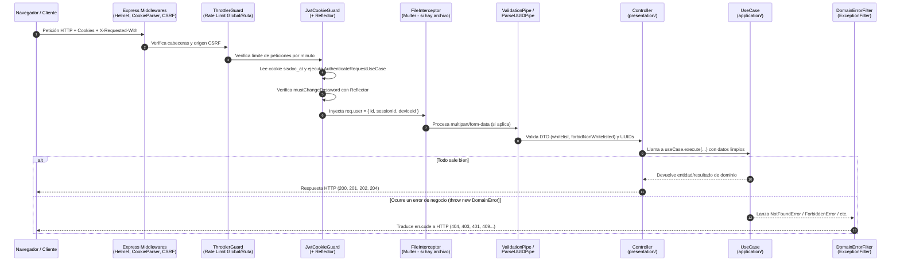

# 🚀 02 - Dominando NestJS en SisDoc: De Junior a Senior/Arquitecto

En este documento aprenderás cómo se utiliza **NestJS** de forma avanzada dentro del `@backend` de SisDoc. Verás cómo NestJS actúa como el **"pegamento"** (contenedor de inversión de control y capa de transporte HTTP/WebSocket) sin contaminar la lógica de negocio.

---

## 1. El Ciclo de Vida Completo de una Petición en SisDoc

Cuando un cliente (por ejemplo, el navegador en React/Vue) hace una petición como `POST /api/v1/documents/:id/reviews`, la petición atraviesa una tubería exacta configurada en `src/app.setup.ts`, `src/app.module.ts` y el controlador correspondiente.



### ¿Por qué separar `main.ts` y `app.setup.ts`?
Fíjate que `src/main.ts` tiene apenas 20 líneas y delega toda la configuración de middlewares, pipes y filtros a **`configureApp(app)`** en `src/app.setup.ts`.
- **¿Para qué sirve esto?** En las pruebas End-to-End (`test/helpers.ts`), `createApp()` levanta la aplicación NestJS en memoria y llama a `configureApp(app)`. Así **garantizas al 100 % que tus tests E2E prueban exactamente los mismos pipes, filtros, cookies y defensa CSRF que el servidor de producción**, sin duplicar código.

---

## 2. Los 7 Pilares de NestJS que debes dominar en este proyecto

### Pilar 1: Módulos (`@Module`) como Fronteras de Encapsulamiento
En NestJS, un `@Module()` define un contenedor cerrado de proveedores (`providers`). Por defecto, nada de lo que declaras en `providers` es visible fuera de ese módulo a menos que lo pongas explícitamente en `exports`.

Mira `src/modules/files/files.module.ts`:
```typescript
@Module({
  imports: [AuthModule], // Importa AuthModule para poder usar JwtCookieGuard en DocumentsController
  controllers: [DocumentsController],
  providers: [
    UploadDocumentUseCase, DownloadDocumentUseCase, ReviewDocumentUseCase, GetHistoryUseCase,
    { provide: DOCUMENT_REPOSITORY, useClass: PrismaDocumentRepository },
    { provide: ACCESS_LOG_REPOSITORY, useClass: PrismaAccessLogRepository },
    { provide: FILE_STORAGE, useClass: LocalFileStorage },
    { provide: DOCUMENTS_API, useClass: DocumentsApiService },
  ],
  exports: [DOCUMENTS_API], // 🔒 SECRETO ARQUITECTÓNICO: ¡Solo exporta DOCUMENTS_API!
})
export class FilesModule {}
```
- Aunque otro módulo importe `FilesModule`, **NestJS le impedirá inyectar `UploadDocumentUseCase` o `DOCUMENT_REPOSITORY`** porque no están en `exports`. Solo puede inyectar `DOCUMENTS_API`.
- **Excepción intencional (`@Global()`):** `PrismaModule` (`src/shared/infrastructure/prisma/prisma.module.ts`) tiene el decorador `@Global()`. Esto hace que `PrismaService` esté disponible en la capa de infraestructura de todos los módulos sin tener que importar `PrismaModule` en cada uno, manteniendo una única piscina de conexiones (`connection pool`) hacia PostgreSQL.

---

### Pilar 2: Inyección de Dependencias con Custom Providers (`provide` / `useClass`)
NestJS tiene dos formas principales de registrar un proveedor:

1. **Proveedor estándar (clase directa):**
   `providers: [LoginUseCase]` → Es un atajo de `{ provide: LoginUseCase, useClass: LoginUseCase }`. Se usa para los casos de uso y controladores.
2. **Proveedor por Token (`Symbol` + `useClass`):**
   `{ provide: USER_REPOSITORY, useClass: PrismaUserRepository }`
   - Aquí se aplica el **Principio de Inversión de Dependencias (la "D" de SOLID)**.
   - El caso de uso pide `@Inject(USER_REPOSITORY) private readonly users: UserRepository`.
   - Si en un test de integración quisieras reemplazar solo el almacenamiento de archivos por uno en memoria, NestJS te permite hacer `.overrideProvider(FILE_STORAGE).useClass(InMemoryFileStorage)`.

---

### Pilar 3: Guards, Metadatos Personalizados (`SetMetadata`) y `Reflector`
Revisa `src/modules/auth/presentation/jwt-cookie.guard.ts`. Este archivo es una clase magistral de cómo hacer autorización elegante en NestJS:

```typescript
const ALLOW_PENDING_PASSWORD_CHANGE = 'auth:allowPendingPasswordChange';

// 1. Creamos un decorador personalizado que pega una "etiqueta" (metadata) al método del controlador
export const AllowWhenPasswordChangePending = () => SetMetadata(ALLOW_PENDING_PASSWORD_CHANGE, true);
```

Y luego, dentro de `JwtCookieGuard.canActivate(ctx: ExecutionContext)`:
```typescript
// 2. El Guard usa Reflector para leer si la ruta actual (o la clase entera) tiene esa etiqueta
const allowed = this.reflector.getAllAndOverride<boolean>(ALLOW_PENDING_PASSWORD_CHANGE, [
  ctx.getHandler(), // Revisa el método (ej. doChangePassword)
  ctx.getClass(),   // Revisa la clase (ej. AuthController)
]);

// 3. Si el usuario está obligado a cambiar su contraseña y la ruta NO tiene el permiso, lanza error 403
if (auth.mustChangePassword && !allowed) throw new PasswordChangeRequiredError();
```
- **¿Por qué es tan potente este patrón?** Porque por defecto **todas las rutas protegidas con `@UseGuards(JwtCookieGuard)` bloquean automáticamente** a los usuarios con contraseña temporal (`mustChangePassword: true`). Es un diseño *"seguro por defecto"* (fail-closed): si creas 50 endpoints nuevos en otros módulos y olvidas pensar en `mustChangePassword`, ya están protegidos. Solo las 3 rutas marcadas explícitamente con `@AllowWhenPasswordChangePending()` (`/auth/me`, `/auth/change-password`, `/auth/logout-all`) los dejan pasar.

---

### Pilar 4: Decoradores de Parámetros Personalizados (`createParamDecorator`)
Mira `src/shared/presentation/current-user.decorator.ts`:
```typescript
export interface AuthUser {
  id: string;
  sessionId?: string;
  deviceId?: string;
}

export const CurrentUser = createParamDecorator((_: unknown, ctx: ExecutionContext): AuthUser =>
  ctx.switchToHttp().getRequest().user);
```
- **¿Qué problema resuelve?** Sin `@CurrentUser()`, tendrías que inyectar `@Req() req: Request` en todos los métodos de tus controladores y hacer `(req as any).user.id`, perdiendo el tipado estricto de TypeScript y acoplando los métodos al objeto `Request` de Express.
- Con `@CurrentUser() u: AuthUser`, el método del controlador recibe directamente el objeto tipado que `JwtCookieGuard` depositó en `req.user`.

---

### Pilar 5: Filtros de Excepciones (`@Catch` y `ExceptionFilter`)
En un proyecto limpio, los casos de uso **nunca** lanzan `NotFoundException` ni `ForbiddenException` de `@nestjs/common` (porque esos son errores HTTP y los casos de uso podrían ejecutarse por CLI, cola de trabajos BullMQ o WebSockets).

En su lugar:
1. El dominio o caso de uso lanza errores hijos de `DomainError` (`src/shared/domain/domain-error.ts` y `src/modules/auth/domain/auth-errors.ts`), cada uno con un `code` semántico (`NOT_FOUND`, `FORBIDDEN`, `SESSION_LIMIT`, `DEVICE_BLOCKED`, etc.).
2. En `src/shared/presentation/domain-error.filter.ts`, la clase `DomainErrorFilter` decorada con `@Catch(DomainError)` intercepta cualquier `DomainError` que escape de un controlador y lo traduce usando un diccionario limpio:

```typescript
const STATUS: Record<string, number> = {
  NOT_FOUND: HttpStatus.NOT_FOUND,                 // 404
  FORBIDDEN: HttpStatus.FORBIDDEN,                 // 403
  VALIDATION: HttpStatus.BAD_REQUEST,              // 400
  INVALID_CREDENTIALS: HttpStatus.UNAUTHORIZED,    // 401
  UNAUTHENTICATED: HttpStatus.UNAUTHORIZED,        // 401
  SESSION_LIMIT: HttpStatus.CONFLICT,              // 409
  DEVICE_BLOCKED: HttpStatus.FORBIDDEN,            // 403
  PASSWORD_CHANGE_REQUIRED: HttpStatus.FORBIDDEN,  // 403
};
```

---

### Pilar 6: Pipes de Validación (`ValidationPipe` y `ParseUUIDPipe`)
En `src/app.setup.ts` (línea 21) se registra globalmente:
```typescript
app.useGlobalPipes(new ValidationPipe({
  whitelist: true,            // Elimina silenciosamente propiedades no declaradas en el DTO
  transform: true,            // Convierte tipos automáticamente y crea instancias de la clase DTO
  forbidNonWhitelisted: true, // Rechaza con 400 Bad Request si el cliente envía campos extra no permitidos
}));
```
- **¿Por qué `forbidNonWhitelisted: true` es crucial para la seguridad?** Evita ataques de *Mass Assignment* (asignación masiva). Como se prueba en `test/auth.e2e-spec.ts` (línea 38), si alguien envía `{ email: 'a@b.com', password: 'x', isAdmin: true }` al login, NestJS rechaza la petición con `400 Bad Request` antes de que llegue siquiera al controlador.
- Además, en `DocumentsController` se usa `@Param('id', ParseUUIDPipe) id: string`. Si alguien pide `/api/v1/documents/no-es-un-uuid/download`, `ParseUUIDPipe` devuelve `400 Bad Request` sin tocar la base de datos.

---

### Pilar 7: WebSockets (`@WebSocketGateway`) y Eventos (`EventEmitter2`)
Mira `src/modules/chat/presentation/chat.gateway.ts` y `src/modules/chat/application/send-message.use-case.ts`:
1. **Autenticación unificada en WebSockets:**
   - Cuando el cliente abre la conexión Socket.io (`handleConnection`), el navegador envía las mismas cookies `HttpOnly` en el handshake (`client.handshake.headers.cookie`).
   - `ChatGateway` usa `this.cookies.readAccessFromHeader(...)` y llama al **mismo** `AuthenticateRequestUseCase` que usa HTTP REST. Si falla, desconecta el socket inmediatamente (`client.disconnect(true)`).
2. **Desacoplamiento por Eventos (`EventEmitter2`):**
   - Al final de `SendMessageUseCase.execute()`, se dispara `this.events.emit('chat.message.sent', message)`.
   - Así, cuando en el futuro agregues un módulo `notifications` o `audit`, ese módulo solo tendrá que escuchar `@OnEvent('chat.message.sent')` sin que tengas que modificar ni una línea del módulo `chat` (Principio Abierto/Cerrado - la "O" de SOLID).

---

## 3. Seguridad Avanzada Implementada en este Backend

Este backend implementa estándares de seguridad de nivel bancario/gubernamental que todo desarrollador Senior debe conocer:

1. **Prefijos de Cookies `__Host-` y `__Secure-` (`auth-cookies.ts`):**
   - En producción (`NODE_ENV === 'production'`), el access token se guarda en `__Host-sisdoc_at` y la clave de dispositivo en `__Host-sisdoc_dk`. El estándar de navegadores obliga a que una cookie `__Host-` tenga `Secure: true`, `Path: /` y no tenga atributo `Domain`, impidiendo que un subdominio comprometido sobrescriba la cookie.
   - El refresh token usa `Path: '/api/v1/auth'`: el navegador **jamás envía el refresh token** cuando pides `/api/v1/documents` o cualquier otra ruta normal, reduciendo drásticamente su exposición.
2. **Defensa CSRF en Doble Capa (`csrf.middleware.ts` + `SameSite=Strict`):**
   - Además de `SameSite=Strict` en las cookies, todo método que modifica estado (`POST`, `PATCH`, `PUT`, `DELETE`) exige la cabecera personalizada `X-Requested-With: XMLHttpRequest` y verifica el `Origin`. Un `<form>` HTML malicioso en otra web no puede enviar cabeceras personalizadas sin disparar un preflight CORS que será bloqueado.
3. **Detección de Robo de Refresh Token (Refresh Token Rotation + Reuse Detection):**
   - Cada sesión guarda `refreshHash` (el actual) y `prevRefreshHash` (el inmediatamente anterior).
   - Si un atacante roba un refresh token y lo usa después de que el usuario legítimo ya lo rotó (o viceversa), `RefreshSessionUseCase` detecta que el token coincide con `prevRefreshHash`, asume que la sesión fue comprometida y **revoca toda la sesión de inmediato** (`ROTATION_REUSE`), dejando fuera tanto al atacante como al usuario legítimo para forzar un login seguro.
4. **Anti-Enumeración de Usuarios por Tiempo (`verifyDummy` en `argon2-password-hasher.ts`):**
   - Si alguien intenta iniciar sesión con un correo que no existe en la base de datos, un servidor ingenuo responde en `2 ms` (porque no hace el hash Argon2), mientras que si el correo sí existe tarda `80 ms`. Un atacante mediría ese tiempo para adivinar qué correos existen.
   - En `LoginUseCase` (línea 56), si el usuario no existe, se ejecuta `await this.hasher.verifyDummy(input.password)` para gastar exactamente el mismo tiempo de CPU con Argon2id y devolver exactamente el mismo mensaje de error.

