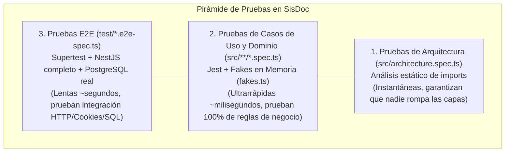

# 🧪 05 - Estrategia de Testing Profesional en SisDoc

Una de las mayores ventajas de la Arquitectura Hexagonal es cómo transforma tu manera de hacer pruebas. En SisDoc existen **3 niveles de pruebas complementarios** (la Pirámide de Testing aplicada a Clean Architecture).



---

## 1. Nivel 1: Pruebas de Arquitectura (`src/architecture.spec.ts`)

- **¿Qué prueban?** No prueban si el login funciona; prueban **la estructura del código**.
- **¿Cómo funciona técnicamente?**
  1. La función `walk(MODULES)` recorre recursivamente todas las carpetas dentro de `src/modules/` y obtiene todos los archivos `.ts` (excluyendo los `.spec.ts` y la carpeta `testing/`).
  2. La función `importsOf(file)` lee el contenido del archivo como texto y usa la expresión regular `/from\s+['"]([^'"]+)['"]/g` para extraer todas las rutas de los `import`.
  3. `layerOf(f)` obtiene el nombre de la subcarpeta (`domain`, `application`, `infrastructure`, `presentation`).
  4. Cada test (`it(...)`) filtra los archivos de una capa y verifica que ninguno tenga un `import` prohibido. Si encuentra alguno, falla mostrando exactamente qué archivo importó qué cosa prohibida (`auth/domain/user.ts -> @nestjs/common`).

---

## 2. Nivel 2: Pruebas Unitarias con Fakes en Memoria vs. Mocks (`fakes.ts`)

Abre `src/modules/auth/testing/fakes.ts` y compáralo con cómo suele hacer tests la mayoría de desarrolladores.

### ❌ El enfoque tradicional con Mocks (`jest.fn()`) — Frágil y verboso
En muchos proyectos verás tests así:
```typescript
// ❌ Mal enfoque: acoplado a cómo está escrito el método por dentro
mockSessionRepo.findByRefreshHash.mockResolvedValueOnce({ id: 's1', userId: 'u1' });
mockSessionRepo.rotate.mockResolvedValueOnce(true);
```
Si mañana cambias el orden de llamadas internas, el mock explota aunque el comportamiento final siga siendo válido.

### ✅ El enfoque Hexagonal de SisDoc: Fakes en Memoria (`InMemoryUsers`, `InMemorySessions`, `FakeClock`)
En `src/modules/auth/testing/fakes.ts` se crearon implementaciones reales pero ligeras en memoria (`Map` y `Array` de JavaScript) de cada puerto:
- `InMemoryUsers implements UserRepository`
- `InMemoryDevices implements DeviceRepository`
- `InMemorySessions implements SessionRepository`
- `FakeClock implements Clock`
- `FakeHasher implements PasswordHasher`
- `FakeTokens implements TokenService`
- `FakeEvents implements SecurityEventLog`

### ¿Por qué la función `buildWorld()` en `fakes.ts` es una joya de diseño?
Mira cómo se escribe un test complejo en `src/modules/auth/application/login.use-case.spec.ts`:
```typescript
it('pasados los 15 minutos vuelve a permitir el ingreso', async () => {
  const w = buildWorld();
  await w.userWithTrustedDevice();
  // 1. Fallamos 5 veces seguidas -> la cuenta queda bloqueada 15 minutos
  for (let i = 0; i < 5; i++) await w.doLogin({ password: 'mala-mala-mala' }).catch(() => undefined);

  // 2. ¡Viajamos en el tiempo 15 minutos y 1 milisegundo sin esperar en la vida real!
  w.clock.advance(minutes(15) + 1);

  // 3. Ahora el login vuelve a funcionar
  expect((await w.doLogin()).kind).toBe('AUTHENTICATED');
});
```
Observa las ventajas:
1. **El test se lee como una historia en español de principio a fin.**
2. **Prueba el flujo real entre varios casos de uso:** En `session-lifecycle.spec.ts`, primero haces `w.doLogin()`, luego pasas el `refreshToken` devuelto a `w.refresh.execute()`, luego cierras sesión con `w.logout.execute()` y verificas que `w.authenticate.execute()` rechace el token inmediatamente. Todo contra las mismas colecciones en memoria.
3. **Control total del tiempo (`FakeClock`):** Puedes probar qué pasa tras 30 minutos de inactividad o tras 12 horas de sesión en **1 milisegundo** de ejecución de CPU.

---

## 3. Nivel 3: Pruebas End-to-End (`test/auth.e2e-spec.ts` y `test/files-isolation.e2e-spec.ts`)

Si ya tenemos pruebas unitarias en memoria, **¿para qué necesitamos pruebas E2E?**

Porque los Fakes en memoria **no prueban**:
- Que las consultas de Prisma (`PrismaSessionRepository`, `PrismaDocumentRepository`) tengan el SQL/índices correctos contra PostgreSQL real.
- Que los decoradores de NestJS (`@UseGuards(JwtCookieGuard)`, `@Throttle`, `@CurrentUser`) estén puestos en el controlador.
- Que las cookies HTTP (`Set-Cookie: sisdoc_at=...; HttpOnly; SameSite=Strict`) y el middleware CSRF (`X-Requested-With: XMLHttpRequest`) funcionen de verdad en Express.
- Que `DomainErrorFilter` traduzca cada `DomainError` al código HTTP correcto (401, 403, 404, 409).

### Anatomía de `test/helpers.ts`:
1. **`createApp()`:** Compila `AppModule` con `@nestjs/testing` y le aplica `configureApp(app)` (la misma función que usa `main.ts`).
2. **`resetDb()`:** Antes de cada test (`beforeEach(resetDb)`), ejecuta:
   ```sql
   TRUNCATE TABLE "users", "security_events", "document_access_logs", "documents" RESTART IDENTITY CASCADE
   ```
   Esto deja la base de datos de pruebas (`sisdoc_test`) completamente limpia en pocos milisegundos para que ningún test contamine al siguiente.
3. **`request.agent(app.getHttpServer())`:** En Supertest, `request(server)` no guarda cookies entre peticiones, pero **`request.agent(server)` simula un navegador real con su propio tarro de cookies (cookie jar)**. Por eso `loggedInUser()` devuelve un `agent` para `ana` y otro `agent` para `luis` en `files-isolation.e2e-spec.ts`, permitiendo simular a dos usuarios distintos interactuando al mismo tiempo.

