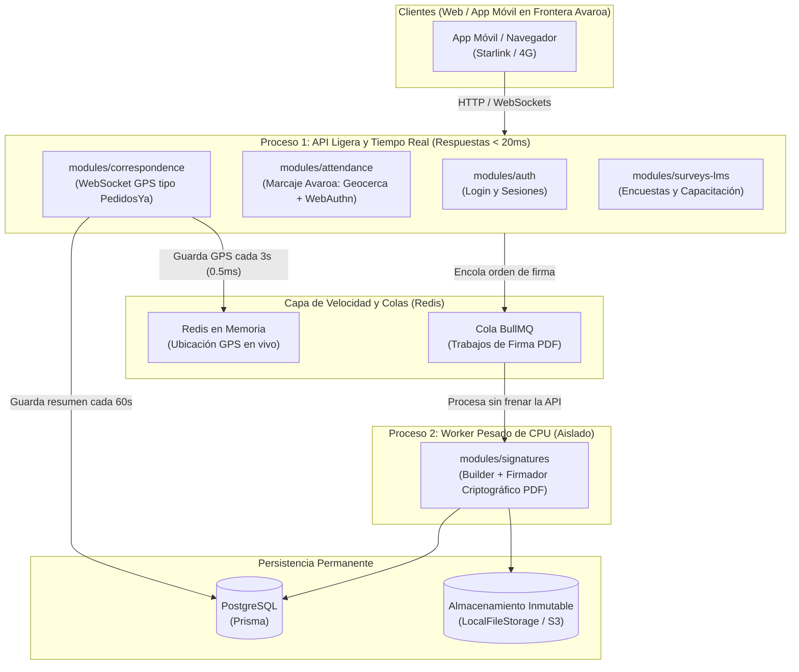

# 🚀 08 - Evaluación Arquitectónica a Futuro: Escalabilidad, Resiliencia y los 4 Nuevos Módulos

Este documento responde a la pregunta clave de arquitectura:
> **¿Aguanta la arquitectura actual de `@backend` (Monolito Modular + Hexagonal en NestJS) si agregamos: 1) Firmador automático de documentos (Builder), 2) Correspondencia con GPS en tiempo real tipo PedidosYa, 3) Marcaje de asistencia con GPS y biometría en frontera (ej. Avaroa con Starlink), y 4) Plataforma de encuestas y creador de contenido/exámenes, garantizando que NO se ralentice y que si un módulo falla los demás sigan funcionando?**

---

## 🎯 Veredicto Corto: **SÍ es la arquitectura ideal, PERO aplicando 4 reglas de aislamiento de recursos (Patrón Bulkhead / Compartimentos Estancos)**

La estructura actual de **Monolito Modular + Arquitectura Hexagonal** que tienes en `@backend` fue pensada precisamente para este crecimiento. De hecho, si revisas tu [`package.json`](file:///c:/sistemas/sisdoc/backend/package.json#L25-L50), verás que **ya están instaladas** las librerías clave para escalar sin ralentizar el servidor:
- `@nestjs/bullmq` y `bullmq` (Colas de trabajo en segundo plano para tareas pesadas como firmar PDFs).
- `ioredis` (Memoria ultrarrápida para guardar ubicaciones GPS en vivo sin ahogar PostgreSQL).
- `@socket.io/redis-adapter` (WebSockets escalables para el mapa en vivo tipo PedidosYa).
- `@nestjs/event-emitter` (Comunicación desacoplada entre módulos).

Sin embargo, en **Node.js** todos los módulos comparten por defecto el mismo hilo de ejecución (*Event Loop*) y la misma piscina de conexiones a PostgreSQL (`PrismaService`). Si metes los 4 módulos nuevos de forma ingenua, **un firmado de PDF pesado bloquearía el CPU** y **el GPS cada 2 segundos saturaría PostgreSQL**.

A continuación tienes el diseño exacto de **cómo evitar que un módulo ralentice o tumbe a los demás** y cómo construir cada uno de los 4 módulos nuevos dentro de tu arquitectura hexagonal.

---

## 🛡️ Parte 1: Las 4 Reglas para que si un Módulo Falla o se Satura, los demás Sigan Funcionando al 100 %

Imagina tu backend como un barco dividido en **compartimentos estancos (Patrón Bulkhead)**: si se inunda el compartimento de encuestas o el firmador de PDFs, el compartimento de asistencia en frontera y el de login no reciben ni una gota de agua.



### Regla 1: Separar el CPU pesado (Firmador de PDFs) en un Worker de BullMQ
- **El problema:** Node.js es *single-threaded* (un solo hilo para código JS). Construir un PDF con un `Builder` y calcular firmas criptográficas (PKCS#7 / PAdES / QR / SHA-256 sobre 30 MB) consume 100 % de CPU durante varios segundos. Si eso corre dentro del controlador HTTP, mientras se firma un documento **nadie en Frontera Avaroa podrá marcar asistencia**.
- **La solución en tu arquitectura:**
  - El módulo `signatures` recibe la petición HTTP, guarda la orden y la mete en una cola de **BullMQ** (`@InjectQueue('pdf-signing')`), respondiendo en `5 ms` con `202 Accepted`.
  - Un proceso separado (`worker.ts`) consume la cola y firma los documentos. Si el firmador crashea por un PDF corrupto o se queda sin memoria, **solo se reinicia el Worker; la API principal (`auth`, `attendance`, `chat`, `correspondence`) nunca cae ni se pone lenta**.

### Regla 2: El GPS en tiempo real ("PedidosYa") va a Redis, NUNCA directo a PostgreSQL en cada segundo
- **El problema:** Si 50 mensajeros envían su ubicación cada 2 segundos, son **1,500 escrituras por minuto**. Si haces `prisma.location.create()` en cada ping, agotas el pool de conexiones de PostgreSQL y todo el sistema se vuelve lento.
- **La solución en tu arquitectura (inspirada en `shouldTouch` de tu módulo `auth`):**
  - En `modules/correspondence/domain/ports.ts` defines dos puertos distintos:
    1. `LiveTrackingStore` (Adaptador en **Redis**): Guarda la última coordenada y velocidad en memoria con expiración (TTL) y publica por Socket.io al mapa del receptor en `< 1 ms`.
    2. `RouteHistoryRepository` (Adaptador en **Prisma/PostgreSQL**): Solo guarda un punto en la base de datos relacional cuando el mensajero se movió más de `100 metros`, pasaron `60 segundos` o cambió el estado del envío (`RETIRADO -> EN_RUTA -> ENTREGADO`).

### Regla 3: Eventos Aislados a Prueba de Fallos (`suppressErrors`)
- Cuando un módulo avisa a otro mediante `EventEmitter2` (como hace [`send-message.use-case.ts`](file:///c:/sistemas/sisdoc/backend/src/modules/chat/application/send-message.use-case.ts#L49)), si el módulo que escucha (ej. `notifications` o `surveys`) lanza un error, no queremos que falle el módulo emisor.
- En los listeners `@OnEvent('...', { async: true })`, envuelve siempre el adaptador de entrada en un bloque `try / catch` con `Logger` (tal como ya hace [`prisma-security-event.log.ts`](file:///c:/sistemas/sisdoc/backend/src/modules/auth/infrastructure/prisma-security-event.log.ts#L13-L20)).

### Regla 4: Despliegue Selectivo gracias al Monolito Modular
- Como [`src/architecture.spec.ts`](file:///c:/sistemas/sisdoc/backend/src/architecture.spec.ts) garantiza que ningún módulo se mete en las tripas de otro, tu código permite tener un archivo `app.module.ts` que carga todos los módulos en un solo servidor hoy, y si mañana quieres que **Asistencia en Frontera (`AttendanceModule`)** tenga su propio contenedor exclusivo para que sea inmune a cualquier caída, puedes crear un `attendance-main.ts` que solo importe `[PrismaModule, AuthModule, AttendanceModule]` **sin cambiar ni una sola línea de código del módulo**.

---

## 🧩 Parte 2: Diseño Hexagonal de tus 4 Nuevos Módulos

Veamos cómo se diseña cada uno respetando las 4 capas (`domain`, `application`, `infrastructure`, `presentation`) de SisDoc:

---

### 📄 1. Módulo Firmador Automático de Documentos con Patrón Builder (`src/modules/signatures/`)

**¿Por qué el patrón Builder es perfecto aquí?**
Porque un documento oficial firmado tiene múltiples partes opcionales y obligatorias que se ensamblan paso a paso antes de estampar la firma: encabezado institucional, cuerpo/plantilla, tabla de metadatos, código QR de verificación, sellos de agua, firmas visuales de 1 o varios firmantes (flujo en cascada) y finalmente el sello criptográfico.

```text
src/modules/signatures/
├── domain/
│   ├── signable-document.builder.ts  # Patrón Builder puro (sin librerías externas)
│   └── signature-policy.ts           # Reglas: quién puede firmar y en qué orden
├── application/
│   ├── ports.ts                      # PDF_RENDERER, CRYPTO_SIGNER, SIGNATURE_QUEUE
│   ├── request-signature.use-case.ts # Encola o ejecuta el proceso de firma
│   └── execute-signature.use-case.ts # Usa el Builder, firma y sube nueva versión a `files`
├── infrastructure/
│   ├── pdf-lib.renderer.ts           # Adaptador que convierte el resultado del Builder en PDF real
│   ├── pkcs7-crypto.signer.ts        # Adaptador criptográfico (certificado P12 / HSM)
│   └── bullmq-signature.processor.ts # Worker asíncrono de BullMQ
├── presentation/
│   └── signatures.controller.ts
├── signatures.module.ts
└── signatures.public-api.ts
```

#### Ejemplo del Builder en `domain/signable-document.builder.ts` (100 % Dominio Puro):
```typescript
import { ValidationError } from '../../../shared/domain/domain-error';

export interface StampSpec {
  signerId: string;
  signerName: string;
  role: string;
  signedAt: Date;
  page: number;
  position: 'BOTTOM_LEFT' | 'BOTTOM_RIGHT' | 'TOP_RIGHT';
}

export interface SignableBlueprint {
  sourceDocumentId: string;
  sourceVersionId: string;
  watermarkText?: string;
  verificationQrUrl: string;
  stamps: StampSpec[];
  requireCryptoSeal: boolean;
}

/**
 * Patrón Builder en el Dominio: construye y valida la especificación
 * de firmado paso a paso antes de enviarla al motor de PDF en infraestructura.
 */
export class SignableDocumentBuilder {
  private watermark?: string;
  private qrUrl?: string;
  private readonly stamps: StampSpec[] = [];
  private cryptoSeal = true;

  constructor(
    private readonly documentId: string,
    private readonly versionId: string,
  ) {}

  withWatermark(text: string): this {
    this.watermark = text.trim().toUpperCase();
    return this;
  }

  withVerificationQr(url: string): this {
    if (!url.startsWith('https://')) {
      throw new ValidationError('El QR de verificación debe usar HTTPS');
    }
    this.qrUrl = url;
    return this;
  }

  addVisualStamp(stamp: StampSpec): this {
    if (this.stamps.some((s) => s.signerId === stamp.signerId)) {
      throw new ValidationError('El mismo usuario no puede estampar dos veces el mismo lote');
    }
    this.stamps.push(stamp);
    return this;
  }

  build(): SignableBlueprint {
    if (this.stamps.length === 0) {
      throw new ValidationError('El documento debe tener al menos un firmante');
    }
    if (!this.qrUrl) {
      throw new ValidationError('Todo documento firmado automáticamente requiere QR de verificación');
    }
    return {
      sourceDocumentId: this.documentId,
      sourceVersionId: this.versionId,
      watermarkText: this.watermark,
      verificationQrUrl: this.qrUrl,
      stamps: [...this.stamps],
      requireCryptoSeal: this.cryptoSeal,
    };
  }
}
```
- **Integración con `files`:** Una vez que el adaptador de infraestructura genera el `Buffer` del PDF firmado, `ExecuteSignatureUseCase` llama al contrato público de `files` (`files.public-api.ts`) para guardar el PDF firmado como **Versión N+1 inmutable** con su nuevo `checksumSha256`.

---

### 🛵 2. Módulo de Correspondencia con Mapa en Tiempo Real tipo "PedidosYa" (`src/modules/correspondence/`)

**¿Cómo funciona el flujo en tiempo real?**
1. Cuando se despacha una hoja de ruta o sobre físico, pasa a estado `IN_TRANSIT` asignado a un `courierId` (el encargado de llevar la correspondencia).
2. El celular del mensajero abre el WebSocket (`CorrespondenceGateway` en el namespace `/tracking`) y envía `location:update` con `{ dispatchId, lat, lng, accuracy, speed, heading, timestamp }`.
3. El caso de uso `UpdateCourierLocationUseCase`:
   - Valida en el dominio que el usuario sea el portador asignado y que el envío esté `IN_TRANSIT`.
   - Guarda la coordenada en el puerto `LIVE_LOCATION_STORE` (implementado con **Redis** en infraestructura).
   - Emite a la sala `dispatch:${dispatchId}` el evento `location:live` para que el marcador se mueva suavemente en el mapa de quien espera el documento.
   - Si ya pasó 1 minuto desde el último guardado en BD (`shouldPersistCheckpoint`), guarda el punto histórico en PostgreSQL para poder reconstruir el recorrido después.

```text
src/modules/correspondence/
├── domain/
│   ├── dispatch.ts            # Estados: CREATED -> IN_TRANSIT -> DELIVERED -> RECEIVED
│   └── tracking-policy.ts     # Regla: shouldPersistCheckpoint (evita saturar PostgreSQL)
├── application/
│   ├── ports.ts               # DISPATCH_REPO, LIVE_LOCATION_STORE (Redis), ROUTE_HISTORY_REPO
│   ├── start-transit.use-case.ts
│   ├── update-location.use-case.ts
│   └── confirm-delivery.use-case.ts
├── infrastructure/
│   ├── redis-live-location.store.ts    # Guarda en Redis con TTL y velocidad < 1ms
│   └── prisma-dispatch.repository.ts   # Guarda envíos y puntos de control en PostgreSQL
└── presentation/
    ├── correspondence.controller.ts    # REST para crear/consultar hojas de ruta
    └── tracking.gateway.ts             # WebSocket en vivo estilo PedidosYa
```

---

### 📍 3. Módulo de Marcaje de Asistencia y Rotación en Recintos / Frontera Avaroa (`src/modules/attendance/`)

Con internet de **Starlink** en Frontera Avaroa tienes excelente ancho de banda y latencia baja (~40-60 ms), por lo que la app móvil se conectará en tiempo real sin problema. Los dos retos reales en frontera son **evitar que marquen fuera del recinto (GPS falso)** y **verificar la identidad con huella/rostro del celular**.

#### A. Geocerca Matemática en el Dominio (`domain/geofence.ts`)
En el dominio defines cada recinto (ej. *Recinto Frontera Avaroa*, *Aduana Interior*, *Puesto de Control 2*) con su centro `(lat, lng)` y su radio en metros (o polígono de coordenadas), además de los puntos de rotación interna (*Checkpoints*).
- La función pura `isInsideEnclosure(userCoord, enclosure)` usa la fórmula de **Haversine** en puro TypeScript (tarda `0.005 ms`, cero base de datos).
- **Anti-GPS falso (Anti-Spoofing en el dominio):**
  - Verifica que la precisión (`accuracy`) del GPS del celular sea buena (ej. `< 35 metros`).
  - **Velocidad imposible:** Si hace 2 minutos marcó en un punto y ahora marca a 50 km de distancia, `isImpossibleTravel(prevCheckIn, currentCheckIn)` detecta *Fake GPS* y bloquea el marcaje registrando un evento de seguridad.

#### B. Reconocimiento Facial / Huella del Celular sin exponer datos biométricos (Estándar WebAuthn / Passkeys / FIDO2)
> **💡 Consejo de Arquitecto Senior:** Nunca envíes la foto de la huella ni del rostro al servidor para compararla con IA pesada si puedes usar el **chip biométrico nativo del celular (Android BiometricPrompt / iOS FaceID / WebAuthn)**.
- **¿Cómo funciona?**
  1. Cuando el funcionario registra su teléfono (que ya pasa por tu flujo de `Device` aprobado `TRUSTED` en `auth`), el celular genera un par de claves criptográficas (`Clave Privada` guardada dentro del chip seguro *TEE/Secure Enclave* del teléfono + `Clave Pública` guardada en tu base de datos).
  2. Cuando el funcionario está en **Frontera Avaroa** y toca *"Marcar Rotación / Asistencia"*:
     - El servidor le envía un reto aleatorio (`challenge`) válido por 60 segundos.
     - El celular pide la **huella dactilar o FaceID nativo del teléfono**.
     - Solo si el rostro o la huella coinciden, el chip del celular firma el `challenge` junto con las coordenadas GPS.
     - Tu backend verifica la firma matemática en **menos de 1 milisegundo** usando `crypto.verify` de Node.js, sin consumir CPU ni arriesgar datos biométricos sensibles.

```text
src/modules/attendance/
├── domain/
│   ├── enclosure.ts           # Recintos (ej. Frontera Avaroa) y puntos de rotación
│   ├── geofence.ts            # Cálculo Haversine puro + detección de GPS falso / velocidad imposible
│   └── attendance-record.ts   # Entrada, Rotación de puesto, Salida
├── application/
│   ├── ports.ts               # ENCLOSURE_REPO, ATTENDANCE_REPO, BIOMETRIC_VERIFIER
│   └── register-checkin.use-case.ts
├── infrastructure/
│   ├── webauthn-biometric.verifier.ts  # Verifica la firma de huella/FaceID del celular
│   └── prisma-attendance.repository.ts
└── presentation/
    └── attendance.controller.ts
```

---

### 📋 4. Módulo de Encuestas, Creador de Contenido y Evaluación de Capacitaciones (`src/modules/training/`)

Este módulo tiene dos caras: **creación de contenido rico + encuestas/exámenes** y **evaluación automática**.

```text
src/modules/training/
├── domain/
│   ├── content-block.ts       # Bloques: VIDEO, PDF_ATTACHMENT, RICH_TEXT, CALLOUT
│   ├── assessment.ts          # Examen / Encuesta: preguntas de opción múltiple, escala, abiertas
│   └── grading-policy.ts      # Función pura que califica un examen y calcula el puntaje/aprobación
├── application/
│   ├── ports.ts               # COURSE_REPO, SUBMISSION_REPO, DOCUMENTS_PORT (hacia files)
│   ├── build-course.use-case.ts
│   └── submit-assessment.use-case.ts
├── infrastructure/
│   ├── files-course.adapter.ts         # Capa anticorrupción hacia files.public-api.ts
│   └── prisma-training.repository.ts
└── presentation/
    └── training.controller.ts
```
- **¿Por qué nunca ralentizará el sistema?**
  - Los videos, manuales PDF y diapositivas no se guardan dentro de la tabla de cursos: se suben a través del módulo `files` y el curso solo referencia `{ documentId, versionId }` (exactamente igual que hace `chat`).
  - La calificación de exámenes (`gradeSubmission` en `domain/grading-policy.ts`) es una operación en memoria sobre un array de respuestas que tarda menos de `1 ms`.

---

## 📊 Resumen Comparativo: ¿Cómo queda tu Backend con los 7 Módulos?

| Módulo | Carga de CPU / Red | ¿Dónde procesa el trabajo pesado? | ¿Qué pasa si este módulo falla? |
| :--- | :--- | :--- | :--- |
| **`auth`** *(Actual)* | Baja (Argon2 en login, 1 SELECT en rutas) | Proceso API Principal | Crítico (protegido y probado con 90+ tests). |
| **`files`** *(Actual)* | Media (Streams de disco) | Proceso API Principal (Streams no bloqueantes) | `chat`, `attendance` y `auth` siguen vivos. |
| **`chat`** *(Actual)* | Baja (Mensajes cortos) | Socket.io (`/chat`) + PostgreSQL | Solo se pausa el chat; el resto opera normal. |
| **`signatures`** *(Nuevo)* | **Alta en CPU** (Builder + Firma PDF) | **Worker BullMQ separado** | La cola retiene los PDFs y reintenta; **la API jamás se frena**. |
| **`correspondence`** *(Nuevo)* | **Alta frecuencia de red** (GPS en vivo) | **Socket.io (`/tracking`) + Redis** | Si el mapa falla, los trámites y asistencia siguen intactos. |
| **`attendance`** *(Nuevo - Avaroa)* | Muy baja (Haversine + firma criptográfica) | Proceso API Principal (`< 5 ms` por marcaje) | Autónomo; incluso puede levantarse en su propio contenedor si se desea. |
| **`training / surveys`** *(Nuevo)* | Baja (JSON de bloques + calificación en memoria) | Proceso API Principal + `files` para adjuntos | Aislado por completo de operaciones críticas de frontera. |

