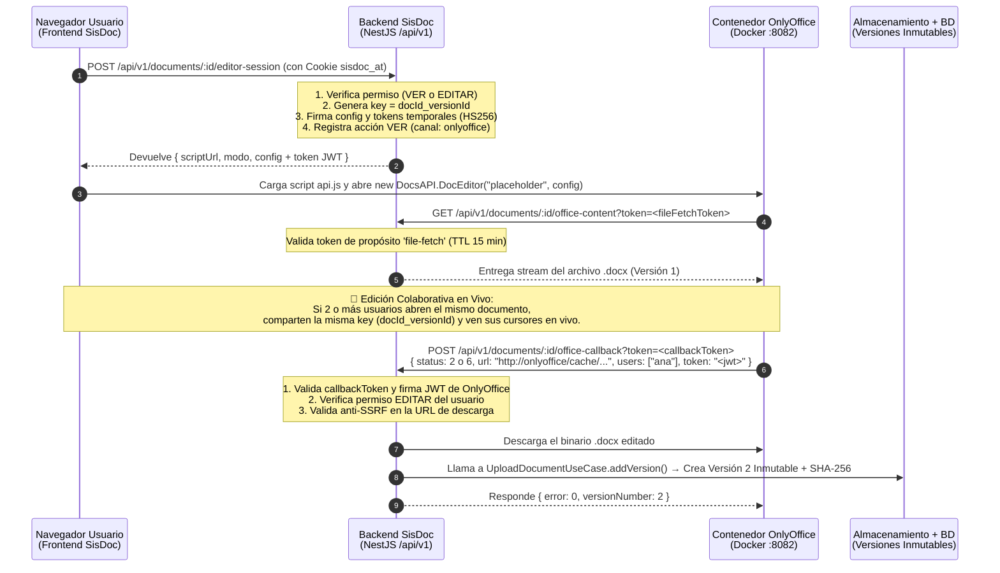

# 📝 10 - Edición en Tiempo Real de Documentos Word, Excel y PowerPoint (OnlyOffice Document Server)

Este documento detalla cómo funciona la **edición colaborativa en tiempo real (Opción 1: OnlyOffice Document Server)** que acabamos de implementar en el módulo `files` de `@backend`, cómo se configura en `.env` y `docker-compose.yml`, qué hace cada archivo en cada capa de la Arquitectura Hexagonal y cómo consumirlo desde el Frontend.

---

## 1. ¿Cómo Funciona el Flujo Completo?



---

## 2. Configuración en `.env` y `docker-compose.yml`

### En [`docker-compose.yml`](file:///c:/sistemas/sisdoc/docker-compose.yml#L24-L38)
Se agregó el contenedor oficial `onlyoffice/documentserver:latest` con validación obligatoria de tokens JWT para que nadie externo pueda usar tu servidor ofimático sin permiso de tu backend:

```yaml
  onlyoffice:
    image: onlyoffice/documentserver:latest
    container_name: sisdoc-onlyoffice
    restart: unless-stopped
    environment:
      JWT_ENABLED: "true"
      JWT_SECRET: "sisdoc_onlyoffice_jwt_secret_2026_seguro"
      JWT_HEADER: "Authorization"
      JWT_IN_BODY: "true"
    ports:
      - "8082:80"
    extra_hosts:
      - "host.docker.internal:host-gateway"
```

### En [`backend/.env`](file:///c:/sistemas/sisdoc/backend/.env) y [`backend/.env.example`](file:///c:/sistemas/sisdoc/backend/.env.example)
Tienes las **4 variables de entorno** que conectan tu backend con el contenedor (incluso si el contenedor de OnlyOffice está en otro VPS):

| Variable en `.env` | Valor en Desarrollo Local | ¿Para qué sirve exactamente? |
| :--- | :--- | :--- |
| `ONLYOFFICE_PUBLIC_URL` | `http://localhost:8082` | URL pública desde donde el navegador del usuario descarga el script `api.js` del editor. En producción sería `https://office.tudominio.com`. |
| `ONLYOFFICE_INTERNAL_URL` | `http://localhost:8082` | URL interna con la que tu backend descarga el archivo `.docx` ya editado desde el contenedor de OnlyOffice (y que sirve como lista blanca anti-SSRF). |
| `ONLYOFFICE_JWT_SECRET` | `sisdoc_onlyoffice_jwt_secret_2026_seguro` | Clave secreta compartida (`HS256`) entre el contenedor de OnlyOffice y tu backend para firmar la sesión de edición y verificar el callback de guardado. |
| `BACKEND_INTERNAL_URL` | `http://host.docker.internal:3000` | URL con la que el contenedor Docker de OnlyOffice alcanza a tu backend NestJS para leer el documento inicial y enviar el callback al guardar. |

---

## 3. Mapa de Archivos Implementados por Capa Hexagonal

### Capa 1: Dominio (`src/modules/files/domain/`)
- **[`document.ts`](file:///c:/sistemas/sisdoc/backend/src/modules/files/domain/document.ts#L164-L212)**:
  - `tipoEditorOfimatico(mimeType)`: Clasifica `.docx`, `.xlsx`, `.pptx` y `.txt` como **editables en vivo** (`editable: true`), y `.pdf` o `.doc` antiguo como **solo visualización** (`editable: false`). Rechaza formatos no ofimáticos (como imágenes sueltas).
  - `claveEdicionColaborativa(documentId, versionId)`: Genera la clave `${documentId}_${versionId}`. Mientras la versión vigente sea la `v1`, todos los usuarios que abran el documento se unen a la **misma sala colaborativa en vivo**. En cuanto se guarda la `v2`, la clave rota automáticamente a `${documentId}_${v2}`.
  - `debeGuardarCallbackOfimatico(status)`: Regla de dominio que indica que solo los estados `2` (listo para guardar al cerrar) y `6` (guardado forzoso en vivo / Ctrl+S) deben crear una nueva versión en SisDoc.
- **[`ports.ts`](file:///c:/sistemas/sisdoc/backend/src/modules/files/domain/ports.ts#L78-L100)**:
  - Define el puerto `OFFICE_EDITOR_PORT` (`Symbol('OFFICE_EDITOR_PORT')`) y la interfaz `OfficeEditorPort`.

### Capa 2: Aplicación (`src/modules/files/application/`)
- **[`office-editor.use-case.ts`](file:///c:/sistemas/sisdoc/backend/src/modules/files/application/office-editor.use-case.ts)**:
  - `openSession(...)`: Verifica acceso con `assertAccess(doc, userId, share, 'VER')` (devuelve `404` si el documento es ajeno). Si el usuario tiene permiso `EDITAR` y el archivo es `.docx`/`.xlsx`/`.pptx`, abre en modo `'EDICION'`; si solo tiene permiso `VER`, lo abre en modo `'LECTURA'`. Registra el acceso en la bitácora con `channel: 'onlyoffice'`.
  - `streamForOfficeServer(...)`: Valida el token temporal `file-fetch` (que vence en 15 minutos) y entrega el stream del archivo al contenedor OnlyOffice.
  - `handleCallback(...)`: Valida tanto el token de query `callback` como el JWT firmado por OnlyOffice, verifica que el usuario tenga permiso `EDITAR`, descarga el archivo modificado y llama a **`this.upload.addVersion(...)`**, creando la **Versión N+1 inmutable** con su nuevo `checksumSha256` y actualizando el registro maestro (`version`, `cambios: 'SI'`, `fechaActualizacion`, `urlWord`).

### Capa 3: Infraestructura (`src/modules/files/infrastructure/`)
- **[`onlyoffice.adapter.ts`](file:///c:/sistemas/sisdoc/backend/src/modules/files/infrastructure/onlyoffice.adapter.ts)**:
  - Implementa `OfficeEditorPort` usando `crypto.createHmac('sha256', ...)` y comparación en tiempo constante (`timingSafeEqual`).
  - Incluye **protección anti-SSRF** en `fetchEditedFile`: comprueba que la URL de donde va a descargar el archivo editado comience estrictamente por `ONLYOFFICE_INTERNAL_URL` o `ONLYOFFICE_PUBLIC_URL`.

### Capa 4: Presentación (`src/modules/files/presentation/`)
- **[`documents.controller.ts`](file:///c:/sistemas/sisdoc/backend/src/modules/files/presentation/documents.controller.ts#L118-L127)**:
  - `POST /api/v1/documents/:id/editor-session`: Protegido por `JwtCookieGuard` y CSRF. Es el endpoint que llama tu Frontend cuando el usuario hace clic en **"Editar en línea"**.
- **[`office-callback.controller.ts`](file:///c:/sistemas/sisdoc/backend/src/modules/files/presentation/office-callback.controller.ts)**:
  - `GET /api/v1/documents/:id/office-content?token=...`: Usado por el contenedor OnlyOffice para leer el archivo.
  - `POST /api/v1/documents/:id/office-callback?token=...`: Webhook donde OnlyOffice entrega el documento editado.

---

## 4. Cómo Consumirlo desde el Frontend (React / Vue / Angular)

Cuando el usuario hace clic en **"Abrir / Editar Word en tiempo real"** en tu frontend:

```typescript
// 1. Pides la sesión de edición a tu backend
const res = await fetch(`/api/v1/documents/${documentId}/editor-session`, {
  method: 'POST',
  credentials: 'include',
  headers: {
    'Content-Type': 'application/json',
    'X-Requested-With': 'XMLHttpRequest',
  },
  body: JSON.stringify({ mode: 'edit' }), // o 'view'
});
const { scriptUrl, config, modo } = await res.json();

// 2. Cargas dinámicamente el script api.js desde el contenedor OnlyOffice (scriptUrl)
// 3. Montas el editor de Word en un <div id="contenedor-word"></div>:
new window.DocsAPI.DocEditor('contenedor-word', config);
```
¡Eso es todo! Al guardar o cerrar el editor, OnlyOffice se comunica con tu backend y la **Versión 2** aparece automáticamente en el historial y registro maestro del documento.

